# ASCII Creatures

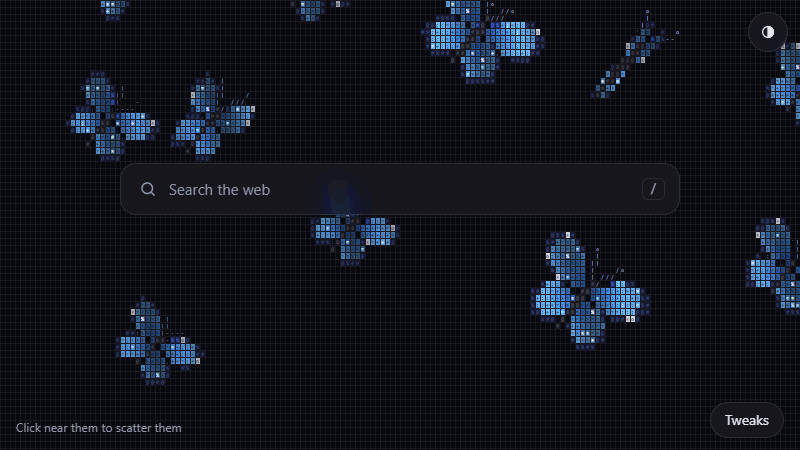

Procedural creatures drawn as ASCII art on a single 2D canvas. There are no sprites, no
frames and no dependencies. Each creature is described by maths and rasterised into a
character grid every frame.

This is a readable reimplementation of pocketstudio.design's "ascii animals" demo.
Butterfly, koi, jellyfish, dragonfly, frog, crane and crab are ported from the original.
Firefly is this project's own addition. The ported creature designs belong to the
original author.

## Creatures

| | |
|---|---|
| 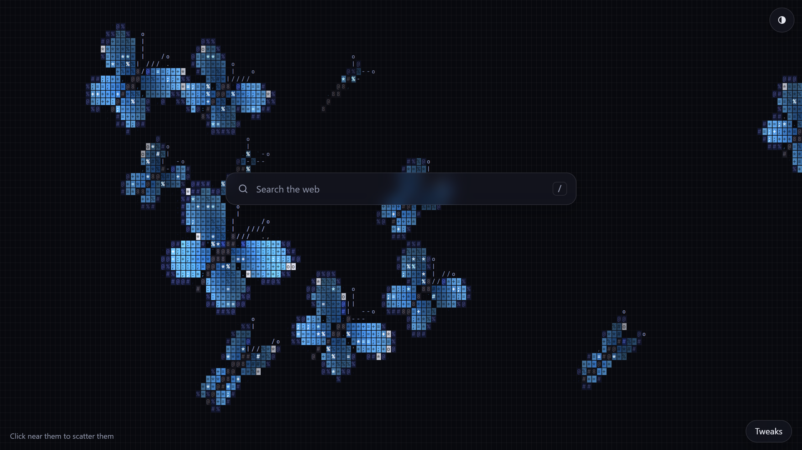 **Butterfly**: flaps, glides, scatters on click | 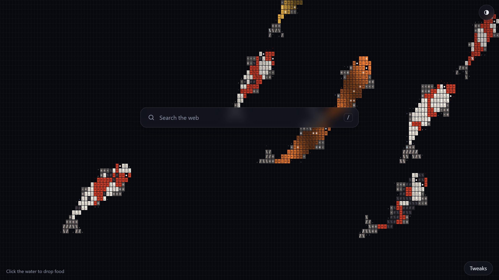 **Koi**: five varieties; click to drop food |
| 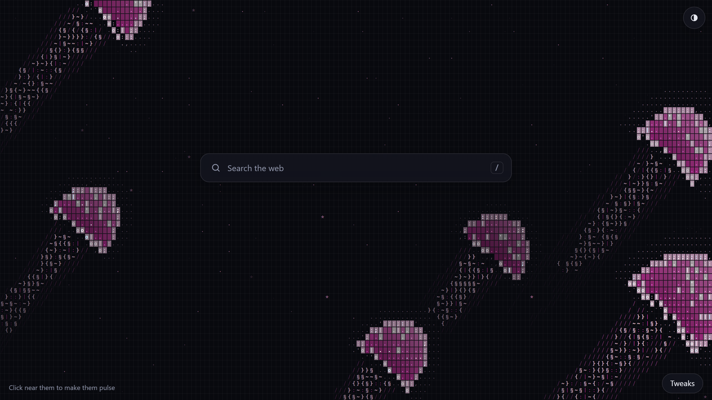 **Jellyfish**: pulses and glows; click to make them pulse | 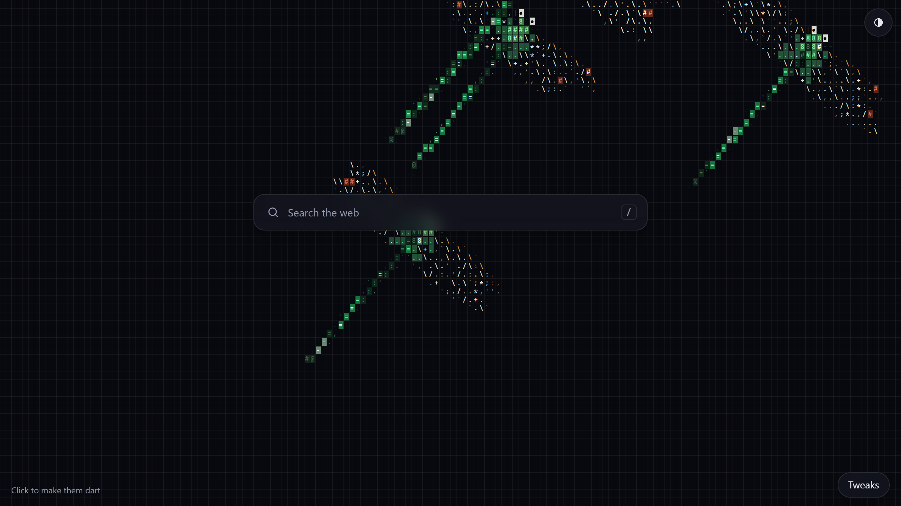 **Dragonfly**: hovers, darts, cruises |
| 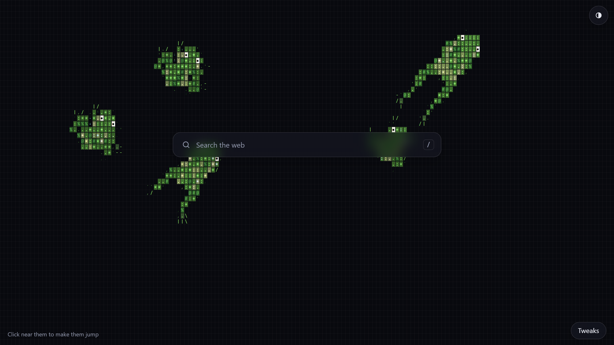 **Frog**: leaps in arcs and splashes on landing | 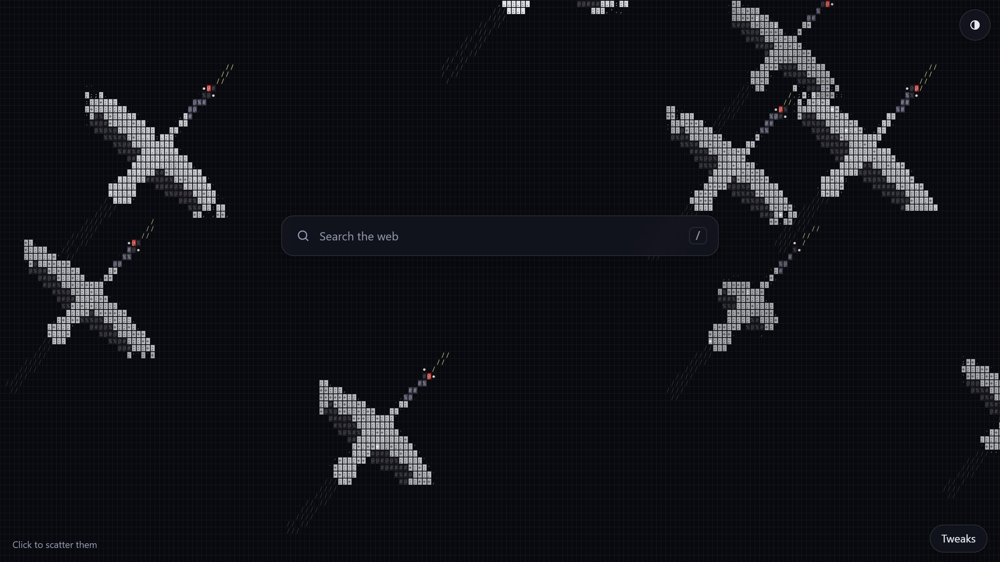 **Crane**: slow wingbeats with a red crown |
| 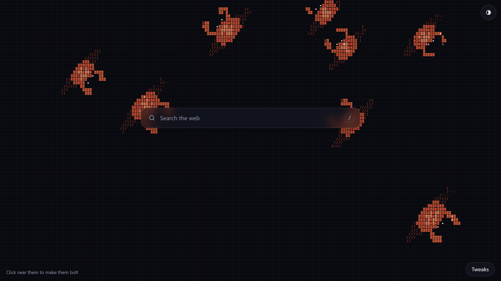 **Crab**: scuttles sideways, bolts when startled | 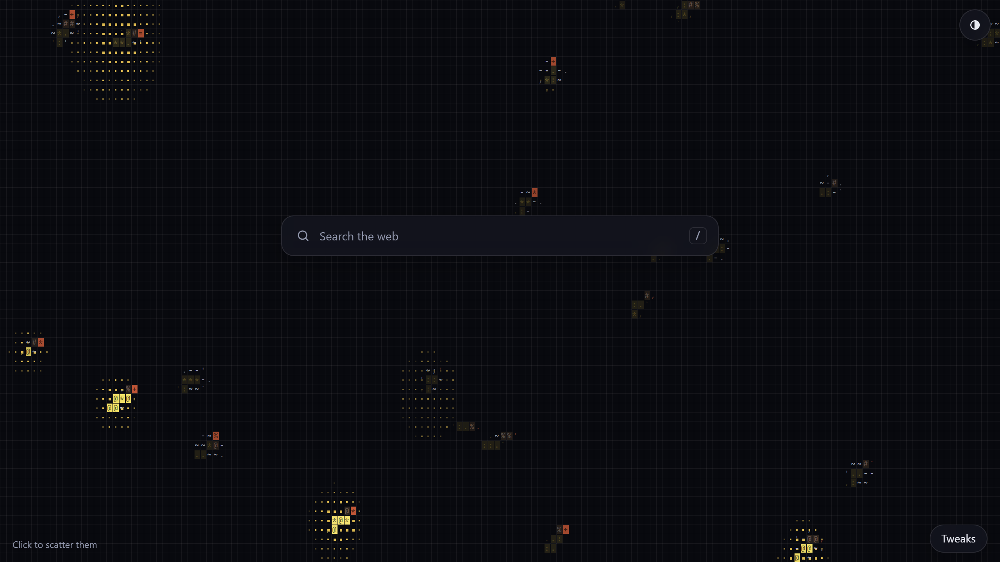 **Firefly**: blinking lanterns |

## Themes and tweaks

Three themes (dark, black and light) cycle from the button in the top-right corner.
The Tweaks panel picks the creature and exposes every movement and look setting, saved
per creature.

| Light | Black | Tweaks |
|---|---|---|
| 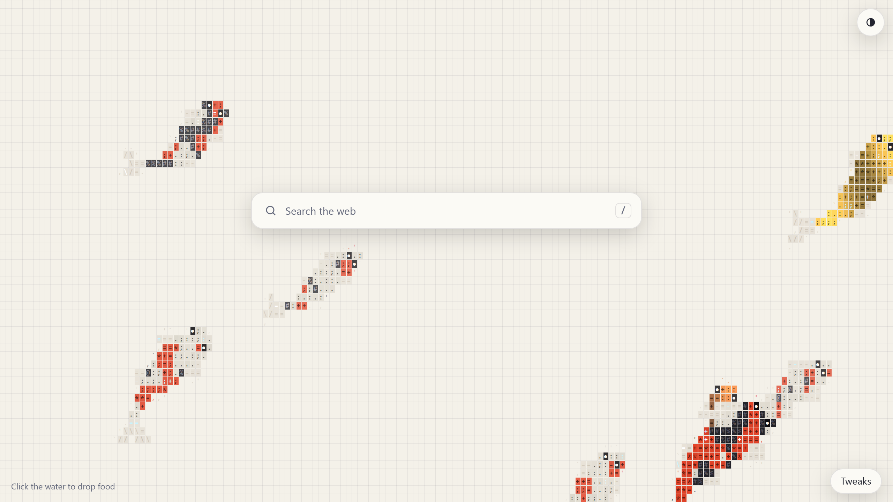 | 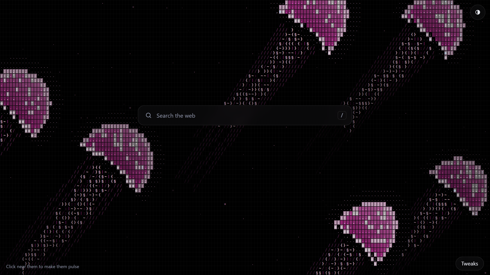 | 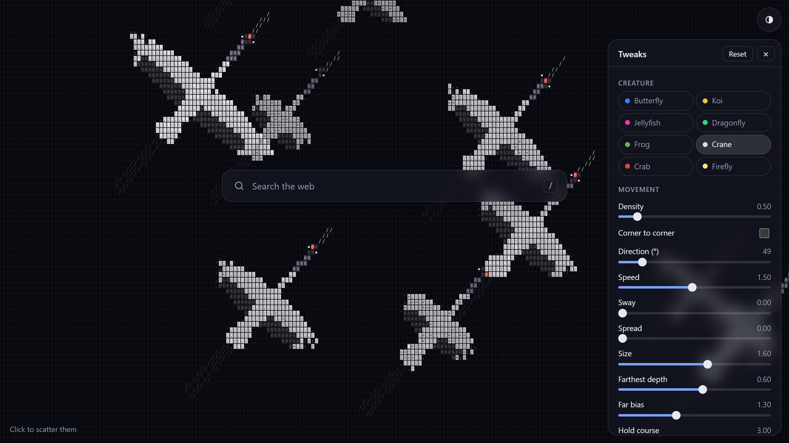 |

## Run

ES modules need a web server (opening `index.html` from disk will not work):

```bash
npx http-server -p 5178 -c-1
```

Then open http://localhost:5178. URL options: `?creature=koi` (butterfly, koi, jellyfish,
dragonfly, frog, crane, crab, firefly) and `?count=12` to fix how many are on screen.

## Install as a new tab page (Chrome, Edge, Brave)

The folder is also a Manifest V3 extension that replaces the new tab page.

1. Open `chrome://extensions` (or `edge://extensions`).
2. Turn on **Developer mode**.
3. Click **Load unpacked** and pick this folder (the one with `manifest.json`).
4. Open a new tab. Chrome asks once whether to keep the change: choose **Keep it**.

No server is needed. Settings, theme and creature are saved in the extension's own
storage. The JetBrains Mono font loads from Google Fonts. Offline, the page falls back
to a system monospace font. After you change the code, click the reload icon on the
extension's card.

## How it works

| File | Role |
|---|---|
| `src/renderer.js` | Character grid. Samples each creature's shape at 5 points per cell, turns coverage + material into glyph, text colour and fill. Strokes drawn with dash, slash and pipe glyphs, eye spots, and a diffusing trail-energy field. Hue shift, sparkle, shimmer, depth fog. |
| `src/flock.js` | Shared simulation: depth, spawning upwind, a common course with sway, separation, steering helpers, click startle. Shared tweak definitions. |
| `src/scene.js` | Fixed 60 Hz timestep loop, resize, clicks, pause when off-screen, still frame for `prefers-reduced-motion`. |
| `src/creatures/*.js` | One object per creature. See the comment in `creatures/index.js` for the interface. |
| `src/tweaks.js` | Generated settings panel; changed values persist per creature in `localStorage`. |

### Adding a creature

Make a file in `src/creatures/` exporting an object with `defaults`, `controls`, `area`,
`scale`, `speed`, `trail`, `create`, `update` and `draw`. Inside `draw`, call
`pen.shape(body, reach, (u, v, paint) => ...)`, where `u` runs along the heading and
`v` to its right, both in body lengths. Return `paint.set(color, Mat.X)` for points
inside the creature and `false` otherwise. Register it in `creatures/index.js`.
